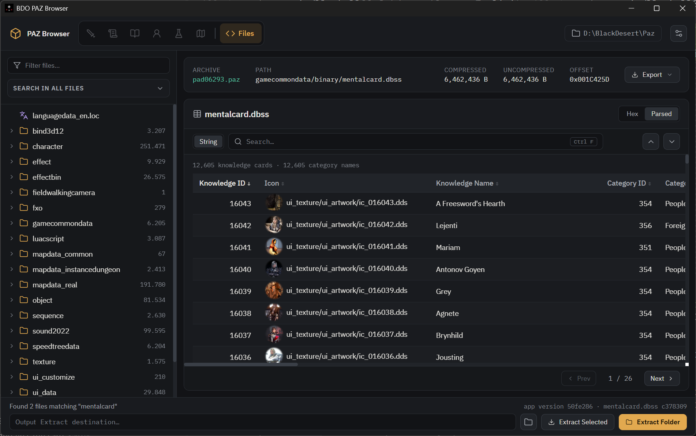

# BDO PAZ Browser & Binary Format Tools

> **Work in progress.** Format coverage is incomplete and the API may change. Contributions and corrections are welcome.

A Python tool for browsing, extracting, and previewing files from Black Desert Online's `.paz` game archives, with a plugin system for parsing BDO-specific binary formats.



## Download

For Windows 10 and 11: download `BDO-PAZ-Browser-v<version>-windows.zip` from the
[latest release](../../releases/latest), unzip it into a folder you can write
to, and run `BDO-PAZ-Browser.exe`. The zip holds `BDO-PAZ-Browser.exe`,
`bdo-paz-cli.exe` (the command-line version, see [CLI](#cli)) and the
`_internal` folder both need.

- The exe is not code-signed, so SmartScreen warns on the first start: click
  **More info**, then **Run anyway**. Each release has a `.sha256` file to check
  the download with `certutil -hashfile <zip> SHA256`.
- The window uses Microsoft Edge WebView2, which Windows 10 and 11 already have.
- Settings and caches go into a `data` folder next to the exe, so moving or
  deleting the folder takes them along. A folder the exe can't write to, such as
  one in Program Files, uses `%LOCALAPPDATA%\BDO-PAZ-Browser` instead.
- A newer release shows up as a teal notice next to the settings button;
  **Update** installs it in a few seconds and keeps `data`. It checks the zip's
  SHA-256 and puts the old version back when the new one can't load its
  handlers. Nothing updates without a click. From the command line:
  `bdo-paz-cli.exe --update-app`.
- New and fixed handlers come without a new release: on start the app
  downloads the changed handler files in the background, then offers a restart
  to use them. A pack that needs a newer app, or fails to load, is skipped and
  the app keeps its own handlers ([Handler Packs](docs/handler.md#handler-packs)).
  From the command line: `bdo-paz-cli.exe --update-handlers`.
- On start the app contacts GitHub twice: the releases API for a newer release
  and the `handlers-latest` release for a newer handler pack. Turn off **Check
  for updates on start** and **Update handlers on start** in the settings and it
  stays offline.
- The bottom bar shows the status and the version, `app version v2026.10.12`,
  and with a parsed file selected the version of its handler,
  `buffsimply.bss 2026.10.14`. Its Output folder and Extract buttons show in
  the Files view only; the Output folder is saved in `paz_config.json`.
  From source both are commits: the checkout's, and the last commit that
  changed the handler's files (with a `+` for uncommitted edits). The bug
  report form asks for both. `--handler-version` prints the handler version
  on the command line, and `--records --json` writes it and the client
  version into the export.

To run from source or write handlers, see [Requirements](#requirements).

## Features

- Tree view of every file in the PAZ archives, with live name search (every match, by folder, then file name, loaded 1,000 at a time as you scroll), content search and a preview panel.
- A Map view next to Files in the toolbar: the world map in Leaflet, built from the client's radar images (`ui_texture/new_ui_common_forlua/widget/rader/minimap_data_pack/rader_X_Y.dds`, one 128 px image per 12,800-unit sector). The first open asks to build the map tiles into the cache folder: on client 3464, 9,802 JPEG tiles over zoom 1 to 7, 216 MB, 13 s with 8 worker processes. Sectors without a radar image, and 2,803 sectors of placeholder art listed in `world_map.py` (client 3464), get one of 12 open sea images picked at random. The map uses world units, so the readout under the cursor shows the game's X and Z.
- The world map's nodes on the Map view: 1,074 nodes on client 3464, each with the game icon of its kind (32 px at every zoom) at its `mapdata_realexplore2.bwp` waypoint and its name as tooltip, and the graph's 1,230 links between them, drawn while both ends show, blue when an end is an open-sea node (Margoria, Ross Sea, Vadabin, Juur Sea) and orange on land (sub-nodes read `Velia - Bahar Investment Bank`). Main nodes show at every zoom, sub-nodes from zoom 6. A Filters panel has a node search (every match, at any zoom), Hide All, layer chips (Player, Markers) and a Nodes card with a toggle, icon and count per kind, a Links option and a shown / total badge. Only the node kinds start on; Player and Markers stay disabled until such a pin exists, and Player turns on when a player pin appears. The filter choices are saved in `paz_config.json` and come back on the next start.
- Map pins from other programs while the app runs: a local HTTP API with a `player` pin (one at a time) and `marker` pins at world positions. Pins can carry one of 29 game world map icons, built with the map tiles from the client's files (the node and position icons of `worldmap_grand_base.xml`, and the radar's own-character pointer for `player`). A marker placed with `save` comes back after a restart, and a click on a pin opens a Remove button. See [Map API](docs/map-api.md).
- Previews for text, hex dumps, DDS images and the parsed tables of the formats in [Supported Formats](#supported-formats). Hex and table tabs are paged, so a large file opens without loading every row. Each file type opens on the tab last picked for it (Parsed, Text or Hex) when the file has that tab, else on its first tab; the tab is saved per extension in `paz_config.json`, with `.bss` and `.dbss` as one type and `.dds`, `.dds1` and `.dds11` as another.
- Text files show numbered lines, their encoding (UTF-8 or CP949) and line ending, with a Wrap lines toggle. XML files (`.xml`, `.ai`, `.cl`, `.mxml`, `.weathercolortablexml`, `.xmp`, `.svg`) colour tags, attributes, values and comments. Images show their size, and for DDS the format and mip count (`DXT5 · 11 mips`), with Fit, 100% and 200% zoom, three backgrounds and the color of the pixel under the cursor. Both have a Hex tab next to them.
- NPC and monster AI scripts (`.ai`) get an AI Script tab: a summary of states, HP gates, variables, the characters that run the script (from `characterstatic.dbss`), macros and imports, behavior filter chips, then one row per state with its developer comment, behavior, cycle time, actions, transitions with their conditions (`300 < distance ≤ 500`, character IDs with names), and the states that lead to it. State names jump to their row; a Text tab keeps the XML. See [aiscript](https://isayzes.github.io/BDO-PAZ-Browser/aiscript_ai.html).
- Class combo lists (`.cl`) get a Combo List tab: one row per combo with its weapon type, the skills it checks as learned and off cooldown (named from LOC), and its steps with skill names, pad keys and the keyboard and mouse input of each action. A Text tab keeps the XML. See [combolist](https://isayzes.github.io/BDO-PAZ-Browser/combolist_cl.html).
- Parsed tables sort on any column across all pages. A table opens sorted by its first column, highest first, and remembers another sort per file.
- Ctrl+F inside the hex tab (byte offset, string or hex pattern), the table tab (records) and the Text tab (lines).
- Export of the open file as raw binary, or its parsed table as CSV, from the Export menu next to the entry details. The CSV file name holds the client and handler versions, `buffsimply_3464_2026.10.12.csv`.
- Game text in the language you pick, with the colours of its `<PAColor>` tags as in game; **Show game text tags** shows the tags too. A client ships only its region's LOC files, so for a missing one the tables show their Korean text and a corner warning says so.
- **Show only handled tables** limits the file tree, searches and folder extraction to files with a parsed table, plus the LOC file.
- A command-line version that lists, extracts and queries parsed records (see [CLI](#cli)).
- New formats are handler files dropped into `handlers/` (see [Writing a Preview Handler](#writing-a-preview-handler)).
- The PAZ index and parsed tables are cached on disk: `detail_dialog.dbss` reopens in 0.25 s instead of 1.3 s (see [Settings and Data Folder](#settings-and-data-folder)).
- The Windows exe updates itself and its handlers from GitHub (see [Download](#download)).

## Contributing Format Coverage

BDO has hundreds of undocumented binary formats. Contributions and corrections are welcome.

**Reverse engineer a new format**: open a new issue using the [file format template](../../issues/new?template=file-format.yml) and title it `filename.ext` (e.g. `yachtdicepreset.dbss` or `.pac`).

**Improve existing docs**: the [format docs](https://isayzes.github.io/BDO-PAZ-Browser/) are not all complete; their sources are in `docs/file-formats/`. Each doc has an **Open Questions** section listing specific unknowns. If you can answer any of them, update the doc directly. Some docs also end with an **In-Game Checks** section: a test that needs a given item, quest, NPC, class or zone. A player who has it can answer the check without reading the binary layout.

**Translate the UI**: UI strings live in [`PAZ-Parser/ui/lang/`](PAZ-Parser/ui/lang/) as small JSON files, one per language. Missing keys fall back to English automatically, so partial translations are fine. See [`TRANSLATING.md`](PAZ-Parser/ui/lang/TRANSLATING.md) for instructions.

See [`CONTRIBUTING.md`](CONTRIBUTING.md) for setup, the checks to run before a pull request, and project conventions.

## Writing a Preview Handler

Drop a `.py` file (not starting with `_`) into `handlers/`. It is auto-loaded at startup.

All parsed-view handlers must implement two methods:

```python
# handlers/myformat_handler.py
from bdo_preview import PreviewHandler, register_handler
from bdo_models import PazEntry

class MyFormatHandler(PreviewHandler):
    def get_records(self, data: bytes, entry: PazEntry, companions: dict[str, bytes]) -> list[dict]:
        # Parse all records once. Returns plain dicts, no HTML.
        # Cached in memory for paging, tab search, and CSV export.
        return [{"id": r.id, "name": r.name} for r in parse(data)]

    def render_records_page(self, records: list[dict], page: int, page_size: int) -> str:
        # Render one page of records as an HTML fragment.
        start = page * page_size
        slice_ = records[start : start + page_size]
        rows = "".join(f"<tr><td>{r['id']}</td><td>{r['name']}</td></tr>" for r in slice_)
        return f"<table><thead>...</thead><tbody>{rows}</tbody></table>"

register_handler("myfile.dbss", MyFormatHandler())
```

The browser automatically handles:

- Prev/Next page navigation
- Inline tab search (Ctrl+F) across all record field values
- CSV export of the full record list

See [docs/handler.md](docs/handler.md) for the full guide, including companion files, shared helpers, registration patterns, and [adding translations](docs/handler.md#localization).

> **Tip:** Press **Ctrl+R** in the GUI to reload all handlers without restarting the app. If you have a file open on the Parsed tab, the preview re-renders automatically with the updated handler.

## Documented Formats

The [format docs wiki](https://isayzes.github.io/BDO-PAZ-Browser/) lists every documented file with its known
share, open questions and in-game checks, and has one page per doc with its
layouts, byte maps and the clients each layout fits. The Wiki workflow
rebuilds it from `docs/file-formats/` whenever a release changes the docs.

## Supported Formats

- `.bss`: 145 of 402 files with a handler.
- `.dbss`: 233 of 374 files with a handler.
- Other formats: 31 with a handler.

## Requirements

- Python 3.14
- [pywebview](https://pywebview.flowrl.com/) for the GUI shell
- [aiohttp](https://docs.aiohttp.org/) for the local stream server
- [numpy](https://numpy.org/) for ICE decryption
- [Pillow](https://python-pillow.org/) for DDS image preview (optional)

```
pip install -r PAZ-Parser/requirements.txt
pip install pillow        # optional
```

### Native Decoders (Optional)

`PAZ-Parser/native/` is the BDO decompressor and the ICE rounds in Rust,
built into the `_bdo_native` module with [PyO3](https://pyo3.rs/) and
[maturin](https://www.maturin.rs/). `paz/bdo_decompress.py` and
`paz/bdo_ice.py` use it when it is installed (`paz/native_backend.py`) and
their Python and numpy versions otherwise, so a checkout without Rust still
runs. On client 3464 (CPU 2, Python 3.14):

| Stage | Python and numpy | `_bdo_native` |
|---|---|---|
| Decrypt the 14 MB texture | 0.140 s | 0.012 s |
| Decompress it | 0.748 s | 0.023 s |
| Read it (disk, decrypt, decompress) | 0.892 s | 0.038 s |
| Extract all of `pad05889.paz` | 1.984 s | 0.368 s |
| Map tile build, all zooms, 8 processes | 16.2 s | 11.0 s |

It needs a Rust toolchain ([rustup](https://rustup.rs/), MSVC on Windows):

```
pip install ./PAZ-Parser/native
```

Install it again after changing the Rust code. The Python versions are the
reference: `PAZ-Parser/tests/test_decompress.py` runs both decompressors on
encoded streams, client payloads and truncated or corrupted copies, and
`PAZ-Parser/tests/test_payload_decode.py` both ICE versions on random data;
each fails when the bytes or errors differ.

## Testing

Handler unit tests use pytest and live beside the handler they cover. Missing test inputs are fetched into the gitignored `PAZ-Parser/tests/fixtures/` cache from the configured PAZ folder. When the installed client changes, the next run fetches all of them again (details in `docs/handler.md`).

Install dev dependencies:

```bash
python -m pip install -r PAZ-Parser/requirements-dev.txt
```

Run all unit tests with the full output (a rows / parse time / LOC summary per handler):

```bash
python -m pytest -v -s
```

Or print only failed tests and a pass/total line:

```bash
python -m pytest --clean
```

Add `-n 12 --dist loadgroup` to run in parallel with pytest-xdist (see
`docs/handler.md`).

Open a PAZ folder once in the GUI if fixture fetching has no saved game path yet. Without one, the tests that need game files are skipped and the rest still run, which is what CI does.

Every pull request into `staging` or `main`, and every push to `staging` that changes code or test config, runs pyright and the tests on a Windows runner (`.github/workflows/ci.yml`). The runner has no client, so it covers only the tests that need no game files; run the full suite locally before opening a pull request.

Type-check `PAZ-Parser/`, `browser.py` and `benchmark.py` (from the repo root, so `pyrightconfig.json` applies):

```bash
python -m pyright
```

Run both the tests and pyright before committing a Python change; both should pass with no errors.

## Benchmarking

`benchmark.py` times the decode path, and a handler's parse, on fixed input,
so two runs on the same machine can be compared.

```bash
# Time every stage of one entry and save the result
python benchmark.py run --output before.json

# Extract every file of one .paz archive, as extract_all does
python benchmark.py run --archive --repeats 5 --output before.json

# Parse one table with LOC and lookup indexes loaded, as the app does
python benchmark.py run --entry itemenchant.dbss --stages parse --output before.json

# Rebuild the client's file index, as the app does after a patch
python benchmark.py run --index --repeats 3 --output before.json

# Build the LOC text index, as every start does (default: the app's language)
python benchmark.py run --loc --output before.json

# Load the entry list from its cache and build the tree, as every start does
python benchmark.py run --folder --output before.json

# After a change: same command, then compare stage by stage
python benchmark.py run --output after.json
python benchmark.py compare before.json after.json

# Where the time goes: cProfile, top 100 functions by cumulative time
python benchmark.py profile --archive --stages extract --save extract.prof
```

The workload is one entry (`--entry`, default
`morningland_boss_03_02_full.dds`, a 14 MB texture), one archive
(`--archive`, default `pad05889.paz`, about 800 mixed files) or the client's
file index (`--index`), one LOC file (`--loc`, optionally a language code
such as `--loc de`) or the folder's entry list (`--folder`). The stages:

| Stage | What it times |
|---|---|
| `decrypt` | ICE decryption of the entry, from memory |
| `decompress` | BDO decompression of the decrypted entry, from memory |
| `read` | The app's path to open a file: disk read, decrypt, decompress |
| `extract` | `extract_all` per file: `read`, then the size check and the write to disk. On an archive, every file in it. The meta file parse is left out: it reads the file table of every archive on every call (the `index` stage) and would hide the decode time |
| `parse` | The handler's `all_records()` (the cached `get_records()` the app's table uses) on the decoded entry, with its companions, LOC in the language picked in the app and the lookup indexes loaded. Only for a file with a parsed view; LOC and the indexes add about 5 s to start-up, so they only load when this stage runs. Every run parses cold (the handler's cached records and index are dropped first) and runs with the garbage collector on, as in the app, which pauses it while the records are built. The input hash covers the entry only, not its companions or LOC |
| `index` | `--index` only: the `.meta` file parse, which reads the file table and decrypts the path block of every archive, with the garbage collector on. The app runs it when its index cache is out of date. The warm-up leaves every archive header in the OS file cache, so the timed runs are warm (about 2 s on client 3458); a cold parse right after a reboot reads 11,000 archives from disk and takes about a minute. For a cold figure, run `--warmup 0 --repeats 1` first thing after a reboot. The input hash is the meta file's |
| `loc` | `--loc` only: `init_loc()` on the LOC file's bytes in memory, the decompress and the text index every table's game text comes from, which the app builds on every start and language switch. With the garbage collector on, as in the app |
| `entries` | `--folder` only: what a start does before the page gets the tree. It loads the entry list from the PAZ index cache and builds the entry maps and the tree, without LOC (`loc`) and the lookup indexes. With the garbage collector on, as in the app. Needs an index cache that matches the client, so open the folder once first. The input hash is the cache file's |

To keep numbers comparable, each run:

- **Pins the process to one CPU** (`--cpu`, default 2) at high priority.
  The decode loops run on one core anyway (ICE and decompression in
  `_bdo_native`, or numpy and Python without it). Pinning
  stops the OS moving the run between cores; on a hybrid Intel CPU an
  efficiency core runs this code about 1.8x slower, so the benchmark refuses
  one and lists the performance cores. The pin is read back after setting
  it and checked again at the end. `--no-pin` runs unpinned and marks the
  result so. Pinning works on Windows and Linux (Linux without the priority
  raise, which needs root).
- **Keeps the input fixed**: the entry bytes are read into memory once, and
  their SHA-256 is saved so a client patch that changes the file shows up.
- **Warms up first** (`--warmup`, default 1), then times `--repeats` runs
  (default 5) with the garbage collector off, as `timeit` does (`parse`
  keeps it on). What a run returns is freed after the clock stops. The minimum
  is the steadiest figure for CPU-bound code; the median and spread show the
  noise.
- **Saves a fingerprint** with the timings: CPU model, logical CPUs, RAM,
  power plan, OS, Python, the decoders (`native` with `_bdo_native`
  installed, else `python`), git commit, the pinned CPU and the input hash.
  `compare` lists every difference besides the code, so a speedup only
  counts when that list is empty; a `python -> native` decoders line is the
  native speedup. Results from before the decoders field (schema 1) still
  read, with the decoders as unknown.

`--memory` adds one run per stage under `tracemalloc` for the peak memory.
It traces every allocation, so that run is many times slower and never
shares a run with the timings. `profile` slows every call too; use it to find
hot functions, and `run` for numbers. Its `--save` file opens in snakeviz or
`pstats`.

## Building the Windows Exe

The Windows build is a folder with `BDO-PAZ-Browser.exe` (the GUI),
`bdo-paz-cli.exe` (the same commands as `browser.py`, with console output) and
the `_internal` folder they share. To build it yourself, on Windows:

```bash
python -m pip install -r PAZ-Parser/requirements-build.txt
python -m pip install ./PAZ-Parser/native   # optional, see Native Decoders
python build.py
```

Without `_bdo_native` installed, `build.py` prints a warning and the exe
decodes with numpy and Python. The release workflow installs it.

`build.py` runs PyInstaller with `browser.spec` into `dist/BDO-PAZ-Browser/`,
checks that `bdo-paz-cli.exe --handlers` lists the same handlers as
`python browser.py --handlers`, and writes
`dist/BDO-PAZ-Browser-v<version>-windows.zip` with a `.sha256` file. The
version is today's date unless `--version 2026.10.12` sets it; `--no-zip`
stops after the checked folder. The handlers are copied in as plain files
under `_internal/handlers`, without their tests and with LF line endings, as
the bundled handler pack. Its `manifest.json` comes from `--handler-manifest
FILE` (the release workflow passes the pack it publishes) or is made from the
checkout with every handler at the build's version; the build fails when the
bundled files differ from it. Adding or changing handlers needs the source
version: the exe has no handler reload (Ctrl+R).

To try the update flow without a GitHub release, set `BDO_PAZ_RELEASES_URL` to a
JSON file in the shape of GitHub's releases API whose asset URLs point at a
newer build's zip and `.sha256`; `file://` URLs work. For handler packs, set
`BDO_PAZ_HANDLERS_URL` to a `manifest.json` and `BDO_PAZ_HANDLER_FILES_URL` to
where its files are, with a `{path}` field (and `{commit}`, which the default
`raw.githubusercontent.com` address uses). `BDO_PAZ_HANDLERS_DIR` runs one
handlers folder for one process.

Releases: `.github/workflows/release.yml` runs on every push to `main`.
`.github/scripts/release_plan.py` publishes an exe release when the app core
changed since the last `v<date>` tag; a change under `PAZ-Parser/handlers`
alone makes none. `.github/scripts/handler_pack.py` compares the handlers with
the `handlers-latest` manifest and, when they differ, uploads a new one there.

## Usage

### GUI

```bash
python browser.py
```

On first launch, click **Open Folder** and select your BDO PAZ directory (typically `Black Desert/Paz`). The index is parsed and cached, and later launches load it from the cache.

### Settings and Data Folder

Settings (`paz_config.json`), saved map pins (`map_pins.json`), caches and
downloaded handler packs live in the data folder: `data\` next to the exe in
the Windows build, or `%LOCALAPPDATA%\BDO-PAZ-Browser` from source and when
the exe folder can't be written. Caches sit in its `cache` folder, one
subfolder per PAZ folder, so a test client keeps its own.

The Settings dialog has one tab per area: **General** (Language, PAZ Folder,
Data Folder, the update checks and the caches every view reads), **Files**
(Table Row Height, game text tags, Show only handled tables, Parsed Table
Cache) and **Map** (Keep map updated, the world map). A view adds its tab
once it exists. It opens on General; Save and Cancel cover every tab.

The **Data Folder** setting picks another folder. The settings and saved map
pins are copied there (replacing any already in it; the old copy stays), the caches in the
old folder are deleted, and the loaded client's PAZ index is saved again in
the new one. A picked folder that is gone, such as an unplugged drive, is
replaced by the default until it is back.

The **Parsed Table Cache** setting is Off, Cache tables when opened (default)
or Cache all tables in the background. The background mode parses every
table A to Z while the app is idle, and the status bar shows the table it is
on and how far the pass is. A table stays cached across a patch that leaves
it, its companions and the LOC text or lookup indexes it reads unchanged.

Each tab lists the caches of the loaded PAZ folder that belong to it, with
their size and a **Delete** button:

| Cache | Tab | After Delete |
| --- | --- | --- |
| PAZ index | General | The next start reads every archive header again, over a minute |
| Lookup indexes | General | Built again on the next start |
| Icon thumbnails | General | Each icon decodes again when shown |
| Parsed tables | Files | Each table parses again when opened |
| World map | Map | The Map view asks to build it again |

**Delete all caches** on General removes all of them but the PAZ index and
shows their total. Below it, General lists the cache folders of other PAZ
folders in the data folder, marks those whose PAZ folder is gone and deletes
one with its **Delete**.

**Keep map updated** is turned on by the Map view's first build. With it on,
a folder load whose client has no finished map (after a game patch) builds
the tiles and pin icons again in the background, and the old client's map is
deleted once the new one is in place.

`paz_config.json` carries a `config_version`. A newer app updates older
settings on load; settings it can't read are renamed to
`paz_config.backup.json` and the app starts with defaults; an older app reads
newer settings as they are and keeps their keys. Settings and caches that an
older version kept next to the code or the PAZ files move to the data folder
on the next start.

### CLI

```bash
# List files matching a pattern
python browser.py --paz-folder "C:/Games/Black Desert/Paz" --list "title*.dbss"

# Extract files matching a pattern
python browser.py --paz-folder "C:/Games/Black Desert/Paz" --file "title.dbss" --output ./out

# Glob extraction
python browser.py --paz-folder "C:/Games/Black Desert/Paz" --file "*title*" --output ./out

# Parsed records, as the GUI table has them (LOC and lookup indexes loaded)
python browser.py --records buffsimply.bss --where buff_id=48723..48728
python browser.py --records skill.dbss --where buff_ids=48723 --fields skill_no,name,buff_ids --json
python browser.py --records languagedata_en.loc --where "text*=Adventure's Boon" --limit 5

# One parsed page as a standalone HTML file with the app's CSS and icons
python browser.py --render buffsimply.bss --page 2 > page.html

# Every registered handler key; needs no PAZ folder
python browser.py --handlers

# The version of the handler that reads a file (file name, PAZ path or key like .loc),
# or of every handler without a name; takes --json / --csv; needs no PAZ folder
python browser.py --handler-version buffsimply.bss
python browser.py --handler-version

# Windows exe: this version and the newest release, then install it (or a downloaded release zip)
bdo-paz-cli.exe --check-app-update
bdo-paz-cli.exe --update-app
bdo-paz-cli.exe --update-app BDO-PAZ-Browser-v2026.10.12-windows.zip

# Windows exe: install a newer handler pack; with a command, it then runs with the new pack.
# Without --update-handlers the CLI never contacts GitHub.
bdo-paz-cli.exe --update-handlers
bdo-paz-cli.exe --update-handlers --records buffsimply.bss

# Lookup indexes: every kind with its size, all entries of one kind, or one ID
python browser.py --index
python browser.py --index knowledge_characters --limit 20
python browser.py --index buff_icon --id 48724

# Parse every file that has a parsed view (or only the ones matching a pattern)
# and list the ones that fail; --json / --csv hold every file's result
python browser.py --paz-folder "D:/Old Client/Paz" --coverage
python browser.py --coverage "quest*" --json > quest_coverage.json

# The Map view's world map as files; --dir is required. Tiles go to
# <dir>/world_map_tiles (every zoom, or only --zoom), the image to
# <dir>/world_map_z<zoom>.jpg (zoom 5 by default; zoom 7 is 31,872 x 27,648 px on client 3464)
python browser.py --map-tiles --dir ./out
python browser.py --map-tiles --dir ./out --zoom 7
python browser.py --map-image --dir ./out --zoom 4
```

If `--paz-folder` is omitted, the CLI reuses the last folder opened in the GUI.
LOC follows the language picked in the GUI settings. Output is UTF-8 whatever
the console code page, and progress messages go to stderr, so redirected
output holds only the result.

`--records <file>` runs the file's handler `get_records()` with its companions,
the rows behind the GUI table and its CSV export. The file is a PAZ path, a
file name, or a pattern that matches one file. Options:

| Option | Meaning |
|---|---|
| `--where field=value` | Equal. Numbers compare as numbers (`0x` hex allowed), text ignores case, `true` / `false` / `yes` / `no` match flags, `none` (or nothing after `=`) matches an empty cell: no value, blank text or an empty list. A list field matches when any item does |
| `--where field=a..b` | Number in the inclusive range; `a..` and `..b` leave one side open |
| `--where field*=text` | Text contains `text`, ignoring case. Text fields are searched as stored, so `*=\n` finds the two-character newline escape |
| `--fields a,b,c` | Only these fields, in this order |
| `--sort field[:desc]` | Sort as the GUI table does (empty values last, text ignoring case, ties in file order), before `--limit` |
| `--json` / `--csv` | Full values as JSON, or CSV like the app's export. The default is an aligned text table; long cells are cut in the middle so both ends stay (a path keeps its file name), and a single row is shown whole. JSON is an object: `file` (the PAZ path), `client_version` (the `.meta` header version), `handler` (its key), `handler_version` (as `--handler-version` prints it, `null` from source without git) and `records` |
| `--limit N` | At most N rows, after filtering |
| `--no-loc` | Skip loading LOC (faster; text columns fall back to inline text) |

Several `--where` options must all match. `--index` takes `--json`, `--csv`
and `--limit` too, and prints JSON as a bare list.

`--coverage [pattern]` runs every handler that builds records over every file
it reads in the loaded client, the way `--records` would, without LOC or
lookup indexes. A file passes when its records build, and an error ends only
that file. The text output lists the failing files with their handler key and
error, and the pass count goes to stderr. `--json` writes an object with
`client_version`, `files`, `passed`, `failed` and `results` (every file:
`file`, `handler`, `ok`, `records`, `error`, `seconds`); `--csv` writes the
same rows. Run on an older client, the failures are the tables whose layout
changed, and the reports of two clients can be diffed.

The CLI always shows game text tags, whatever the GUI setting: `--render`
draws them next to the colours, and `--records` lists the tagged text in the
fields starting with `_` (`_description_pa` next to the plain `description`).
CSV leaves those fields out, like the app's export.

## Project Structure

```
PAZ-Parser/
├── app_dirs.py             # Data folder: config, its location pointer, cache folder per PAZ folder
├── app_version.py          # Exe version and commit from build_info.json; none from source
├── bdo_app.py              # Entry point, GUI launch + CLI argument parsing
├── bdo_models.py           # Data models (shared by all handlers)
├── bdo_preview.py          # Preview handler registry + built-in handlers
├── preview_views.py        # Text and image view markup, DDS header facts
├── bdo_server.py           # Local HTTP server: stream preview, map tiles, map API
├── world_map.py            # Map tile grid: radar sectors, tile pyramid, sea fillers
├── world_map_build.py      # Map tile build in a process pool, into the cache folder
├── world_map_export.py     # Map tiles and single map images for --map-tiles / --map-image
├── map_pins.py             # Map pins: types, validation, the session's pin store
├── map_pins_file.py        # Saved map pins in map_pins.json
├── map_icons.py            # Map pin icons cut from the client's world map and radar textures
├── map_icons_build.py      # Map pin icons as PNG files in the map's cache folder
├── map_nodes.py            # Worldmap nodes for the Map view, from the MAP_NODE lookup index
├── map_api.py              # The map API routes on the local server (docs/map-api.md)
├── conftest.py             # pytest setup and handler test summary output
├── handler_api.py          # HANDLER_API and what handler code may import
├── record_export.py        # Records as CSV (GUI export and --records --csv)
├── ui_text.py              # UI text for Python-built messages, from ui/lang/*.json
│
├── cli/                    # Command-line commands, one module each
│   ├── session.py          # Loads the PAZ folder headless through Api
│   ├── parsed_file.py      # Resolves a file name to handler, payload, companions
│   ├── files.py            # --list, --file
│   ├── formats.py          # --formats, --handlers, --handler-version
│   ├── records.py          # --records (record_filter.py, record_output.py)
│   ├── render.py           # --render
│   ├── index.py            # --index
│   ├── coverage.py         # --coverage
│   └── update.py           # --check-app-update, --update-app, --update-handlers
│
├── updates/                # App and handler updates for the Windows exe
│   ├── releases.py         # The newest release from the GitHub releases API
│   ├── install.py          # Download, SHA-256 check, unpack, the swap helper
│   ├── handler_manifest.py # Handler pack files, manifest.json, per-handler versions
│   ├── handler_sets.py     # The pack files each loaded handler reads
│   ├── handler_versions.py # The running version of a handler (footer, CLI)
│   └── handler_packs.py    # The pack a start runs, installing a newer one, cleanup
│
├── bench/                  # benchmark.py commands (see Benchmarking)
│   ├── cli.py              # run, compare, profile
│   ├── stages.py           # Workloads (one entry, one archive) and their stages
│   ├── timing.py           # Warm-up, timed repeats, optional peak memory
│   ├── pinning.py          # CPU pinning and the performance core check
│   ├── win32.py            # Windows API calls through ctypes
│   ├── machine.py          # Machine fingerprint saved with each result
│   ├── results.py          # Result JSON, read back with every field checked
│   ├── compare.py          # Stage speedups and environment differences
│   ├── profiling.py        # cProfile of one stage
│   └── report.py           # Console tables
│
├── api/                    # pywebview JS API bridge
│   ├── bdo_api.py          # Routing and dispatch
│   ├── bdo_api_helpers.py  # Shared constants and utilities (_norm, _file_icon)
│   ├── bdo_languages.py    # The 13 game languages, their LOC files and UI support
│   ├── bdo_icon_images.py  # Icon thumbnails, the icon popup image and sprite crops
│   ├── bdo_api_preview.py  # Preview assembly and entry loading (PreviewMixin)
│   ├── bdo_api_caches.py   # Cache folder, parsed table cache modes (CacheMixin)
│   ├── bdo_api_cache_usage.py# Cache table: size and Delete per cache, Delete all, other clients (CacheUsageMixin)
│   ├── bdo_records_store.py# Parsed table cache keys and dependency digests
│   ├── bdo_records_prefill.py# Background pass that caches every table
│   ├── bdo_recent_tables.py# Which handlers keep their parsed tables in memory
│   ├── bdo_api_search.py   # File content search, single-file and cross-file (SearchMixin)
│   ├── bdo_api_file_search.py# File name search, sorted and paged for the tree (FileSearchMixin)
│   ├── bdo_api_updates.py  # The update banner check and one-click install (UpdateMixin)
│   ├── bdo_api_handler_updates.py# Handler pack update on start, Check now, restart, versions
│   ├── bdo_api_world_map.py# Map view state, build prompt, background builds, pin icons (WorldMapMixin)
│   ├── bdo_api_map_pins.py # Map pins for the page and the popup's Remove (MapPinsMixin)
│   └── config_migrations.py# paz_config.json versions and the steps between them
│
├── paz/                    # PAZ archive reading and caching
│   ├── bdo_cache.py        # PAZ index cache
│   ├── bdo_ice.py          # ICE cipher implementation
│   ├── bdo_meta_reader.py  # Meta file reader
│   ├── bdo_payload_cache.py# LRU payload cache
│   ├── bdo_payload_reader.py# Entry payload read: ICE decryption, then decompression
│   ├── bdo_decompress.py   # BDO decompression: Python decoder, _bdo_native when installed
│   ├── native_backend.py   # The _bdo_native functions, None when it is not installed
│   ├── source_fingerprint.py# Code hash that invalidates the disk caches
│   ├── bdo_thumbnail_cache.py# Icon thumbnail cache (SQLite, in the cache folder)
│   ├── bdo_records_cache.py# Parsed table cache (SQLite, in the cache folder)
│   ├── bdo_paz_extract.py  # File extraction logic
│   └── bdo_paz_reader.py   # PAZ archive parser
│
├── native/                 # _bdo_native, the decoders in Rust (see Native Decoders)
│   ├── src/decoder.rs      # Port of the Python decompressor, range checked, never panics
│   ├── src/ice.rs          # ICE rounds; the key schedule and S-boxes come from bdo_ice.py
│   ├── src/lib.rs          # PyO3 module: unpack(), ice_crypt(), both without holding the GIL
│   └── _bdo_native.pyi     # Type stub, shipped in the wheel and read by pyright
│
├── format_docs/            # Checks the format docs against docs/format-docs.md
├── wiki/                   # The format docs as a static site, built by build_wiki.py (static/ holds its CSS and JS)
│
├── tests/                  # Unit test framework and gitignored fixtures
│   ├── framework.py        # Public re-export for test helpers
│   ├── specs.py            # DeclaredCountTest, TargetTest, SchemaTest, RangeTest
│   ├── declared.py         # Row counts read from the input for DeclaredCountTest
│   ├── case_input.py       # CaseInput: the bytes a case parsed
│   ├── models.py           # HandlerCase, HandlerResult
│   ├── runner.py           # run_case()
│   ├── fixtures.py         # Auto-fetches test inputs from PAZ folder
│   ├── fixture_sync.py     # Refreshes fixtures when the client changes
│   ├── decompress_streams.py# BDO stream encoder for the decompress tests
│   └── fixtures/           # Gitignored cached binaries
│
├── ui/                     # Web UI (HTML + JS + CSS)
│   ├── index.html
│   ├── app.js              # Entry point, assembles feature modules
│   ├── style.css           # CSS entry point, imports css/ modules
│   ├── css/                # Per-component stylesheets (numbered load order)
│   ├── fonts/              # IBM Plex woff2 files and their OFL licence
│   ├── vendor/leaflet/     # Leaflet 1.9.4 (map view) and its BSD-2 licence
│   └── js/
│       ├── core/           # Shared state, helpers and the icon sprite
│       └── features/       # Feature modules (tree, search, extraction, …)
│
└── handlers/               # Format preview plugins (auto-loaded)
    ├── dbss_handler.py     # DBSS entry point
    ├── _dbss/              # DBSS format implementations
    │   ├── common/         # Shared binary/HTML helpers
    │   ├── title/
    │   ├── titleoffset/
    │   ├── titlebuff/
    │   ├── mentalcard/
    │   ├── mentaltheme/
    │   ├── knowledgelearning/
    │   ├── npcgift/
    │   ├── quest/
    │   └── questgroup/
    └── _common/            # Helpers shared across formats
        └── loc.py

docs/
├── handler.md              # Guide for writing preview handlers
├── format-docs.md          # How a format doc is written; format_docs/ checks it
├── style-guide.md          # UI color palette and component reference
└── file-formats/           # Per-format binary layout documentation

browser.py                  # Starts the app: GUI, or a CLI command
benchmark.py                # Decode benchmarks (see Benchmarking)
build.py                    # Windows build (see Building the Windows Exe)
build_wiki.py               # Format docs wiki into _site/ (see docs/format-docs.md)
browser.spec                # PyInstaller spec that build.py runs
```

## Contact

To get in touch with me, add me on Discord: `sayzes`.

## Disclaimer

This project is for research purposes only. BDO game data is copyright Pearl Abyss. Do not redistribute extracted game assets.
